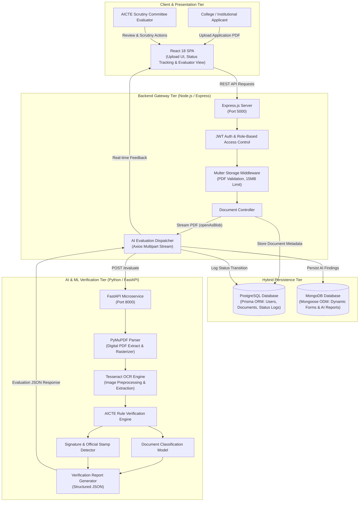
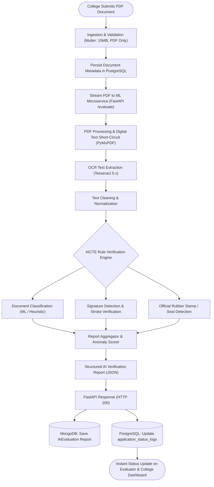
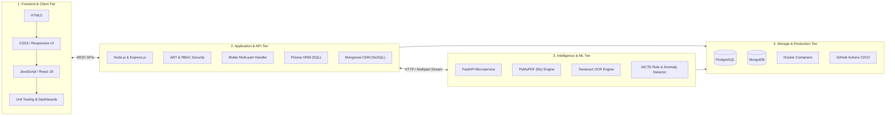

<p align="center">
  
</p>

<h1 align="center">ANUMATI</h1>
<h3 align="center">AI-Supported AICTE Approval Process Portal</h3>

<p align="center">
  <b>Automated Network for Unified Management and AI-Tracked Institutions</b><br />
  A high-throughput, secure, intelligent portal streamlining and automating the AICTE institutional approval lifecycle.
</p>

<p align="center">
  
  
  
  
  
  
</p>

---

## 📌 Project Overview

* **Core, Server, API, Security & Authentication:** This portal requires a highly secure, role-based backend architecture. You will need to build robust APIs to handle heavy document uploads and implement strict authentication (like JWT) because you are dealing with official government and institutional data.
* **Hybrid Database (PostgreSQL + MongoDB):** This is the perfect use case for a hybrid database approach. PostgreSQL is utilized for structured, relational records (user accounts, college hierarchies, strict approval statuses via Prisma), while MongoDB persists dynamic forms, institutional payloads, JSON anomaly logs, and AI evaluation outputs via Mongoose.
* **Automated Document Verification & Machine Learning:** The AI component focuses on automated document verification. The ML side performs PDF processing, OCR text extraction via PyMuPDF and Tesseract, signature and official seal verification, and automated compliance checking against AICTE rule books to accelerate the scrutiny workflow.
* **Modern Reactive Web Interfaces:** A clean, responsive frontend dashboard enables colleges to track their approval progress in real-time, while providing an evaluator interface for AICTE committee members to inspect anomalies and approve or reject submissions.

---

## 🏛️ System Architecture

ANUMATI employs an asynchronous, event-driven architecture with dedicated microservices and hybrid data persistence.

### Architecture Overview
<p align="center">
  
</p>

### End-to-End System Architecture Diagram



### Document Verification Pipeline



---

## 🛠️ Full-Stack Development (FSD) Roadmap & Tech Stack

<p align="center">
  
</p>

### Layered Tech Stack Architecture



---

## 🗺️ Project Roadmap & Execution Timeline

For complete details on current milestones and engineering plans, see [ROADMAP.md](ROADMAP.md).

### High-Level Milestone Phases
<p align="center">
  
</p>

### Detailed Timeline & Module Schedule
<p align="center">
  
</p>

---

## 📁 Project Structure

The project is structured as a monorepo with distinct services. Below is a breakdown of the directory structure:

```plaintext
/
├── backend/
│   ├── api/             # API routes (e.g., Express routes)
│   ├── prisma/
│   │   ├── migrations/
│   │   └── schema.prisma
│   ├── scripts/
│   │   └── test-db.js
│   ├── src/
│   │   ├── config/          # Configuration files (db, auth)
│   │   │   ├── db.js        # Prisma client (SQL)
│   │   │   └── mongo.js     # MongoDB connection setup
│   │   ├── controllers/     # Route handlers
│   │   ├── generated/
│   │   ├── middleware/      # Authentication (JWT), upload, error handling
│   │   ├── services/        # Business logic & AI dispatcher
│   │   ├── models/          # MongoDB Schemas
│   │   │   ├── AiEvaluation.js
│   │   │   └── DynamicApplicationForm.js
│   │   └── server.js
│   ├── .env.example
│   ├── package-lock.json
│   ├── package.json
│   └── prisma.config.ts
│
├── frontend/
│   ├── public/
│   │   ├── dashboard.html
│   │   └── index.html
│   ├── src/
│   │   ├── assets/          # Architecture diagrams, logos, roadmap assets
│   │   │   ├── AICTE.png
│   │   │   ├── COMPLETE_TIMELINE.jpg
│   │   │   ├── FSD_ROADMAP.jpg
│   │   │   ├── PROJECT_ARCHITECTURE.jpg
│   │   │   └── PROJECT_ROADMAP.jpg
│   │   ├── components/      # Reusable UI components
│   │   ├── pages/           # Page-level components
│   │   ├── services/        # API communication
│   │   ├── App.js           # Main application component
│   │   ├── App.jsx
│   │   └── index.js
│   ├── home.html
│   ├── package-lock.json
│   ├── webpack.config.js
│   └── package.json
│
├── ml/
│   ├── app.py               # FastAPI server exposing /evaluate
│   ├── notebooks/           # Jupyter notebooks for EDA
│   ├── src/
│   │   ├── ocr/             # OCR logic
│   │   ├── signature/       # Signature & stamp verification logic
│   │   └── anomaly/         # Anomaly detection & rule engine
│   ├── docs/                # Benchmark & model architecture evaluations
│   ├── ml.py
│   └── requirements.txt
│
├── .github/
│   └── workflows/           # CI/CD workflows
├── .gitignore
├── CHANGELOG.md
├── README.md
├── ROADMAP.md
├── SECURITY.md
└── VERSION.md
```

---

## 🚀 Getting Started

### Prerequisites

Ensure you have the following installed on your local machine:
*   [Node.js](https://nodejs.org/) (v18.x or higher)
*   [Python](https://www.python.org/) (v3.9.x or higher, preferably 3.11–3.13)
*   [Docker](https://www.docker.com/products/docker-desktop/) (for running databases)
*   [Git](https://git-scm.com/)
*   [MongoDB](https://www.mongodb.com/try/download/community) (Local installation via Compass/Docker, or a free cloud cluster via MongoDB Atlas)
*   [PostgreSQL](https://www.postgresql.org/) (Local installation or Docker container)

### Installation & Setup

1.  **Clone the repository:**
    ```bash
    git clone https://github.com/Harsh-Bajpai-1194/ANUMATI.git
    cd ANUMATI
    ```

2.  **Set up Databases:**
    1. Ensure you have **PostgreSQL** running locally (or via Docker) for relational data.
    2. Ensure you have **MongoDB** running locally, or create a free shared cluster on MongoDB Atlas for unstructured data.
    3. Copy the example environment variables file:
       ```bash
       cp backend/.env.example backend/.env
       ```
    4. Update `DATABASE_URL` (PostgreSQL) and `MONGODB_URI` (MongoDB) in `backend/.env` with your connection strings.
    5. Run the Prisma migrations to set up the PostgreSQL schema:
       ```bash
       cd backend
       npx prisma migrate dev
       cd ..
       ```

3.  **Install Dependencies:**
    Install dependencies for each service from the root directory:
    ```bash
    # Install backend dependencies
    cd backend && npm install && cd ..

    # Install frontend dependencies
    cd frontend && npm install && cd ..

    # Install ML service dependencies
    cd ml && pip install -r requirements.txt && cd ..
    ```

4.  **Environment Variables:**
    Each service (`backend`, `frontend`, `ml`) requires its own `.env` file for configuration. Check `.env.example` in each directory to document the required variables.

5.  **Running the Services:**
    ```bash
    # Terminal 1: Backend Server (Port 5000)
    cd backend && npm run dev

    # Terminal 2: ML Microservice (Port 8000)
    cd ml && uvicorn app:app --host 0.0.0.0 --port 8000 --reload

    # Terminal 3: Frontend Development Server
    cd frontend && npm start
    ```

> [!NOTE]
> **Server Execution & Graceful Disconnect:** The backend server maintains active connections to both PostgreSQL and MongoDB simultaneously. It includes a graceful shutdown protocol. To stop the server cleanly and disconnect the databases without hanging ports, always use `Ctrl+C`.
