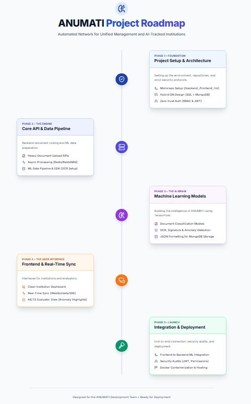
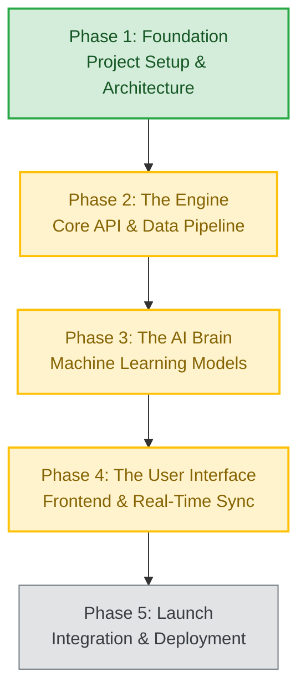
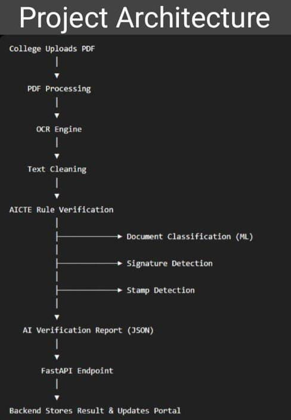
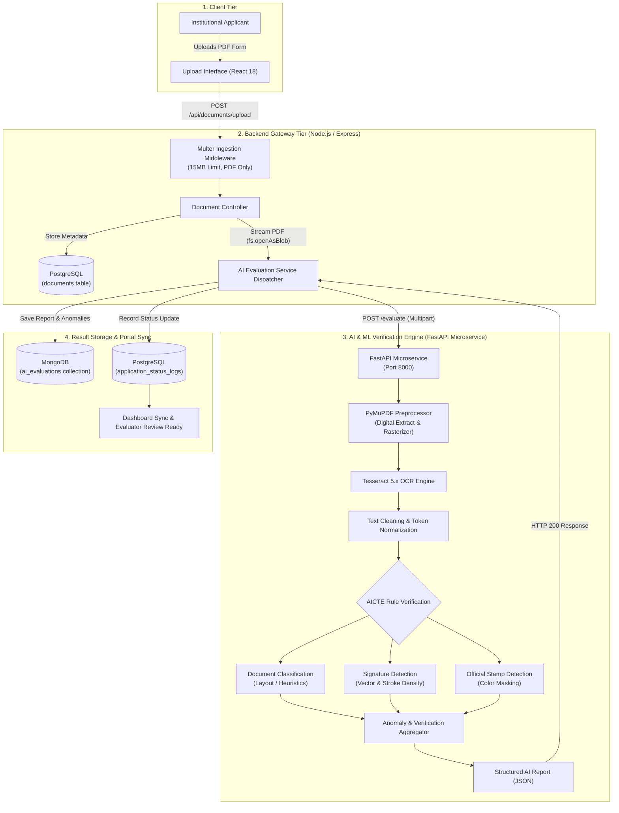
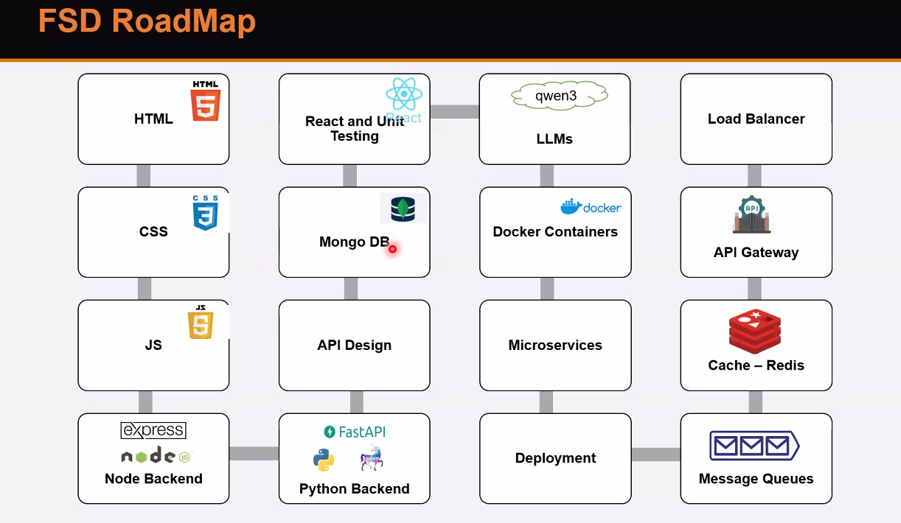
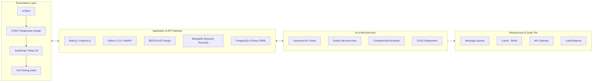
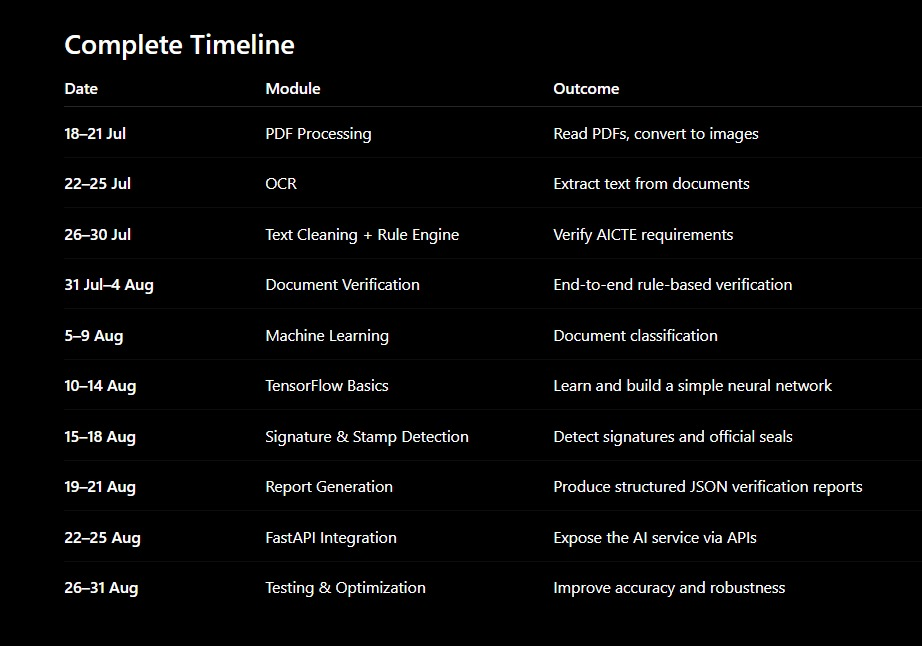

  

# ANUMATI Project Roadmap & Execution Plan

**ANUMATI** (**A**utomated **N**etwork for **U**nified **M**anagement and **A**I-**T**racked **I**nstitutions) is an AI-supported portal designed to streamline, automate, and accelerate the AICTE approval process for educational institutions.

---

## 🗺️ High-Level Project Roadmap

  

### Phase Lifecycle Overview (Mermaid)

---

## 1. Project Current Status Overview

| Phase | Description | Key Modules | Status |
| :--- | :--- | :--- | :--- |
| **Phase 1: Architecture & Setup** | Monorepo structure, Prisma SQL & MongoDB schemas, config files | Monorepo, Prisma, Mongoose, Auth Config | **Completed** |
| **Phase 2: Backend APIs** | Routing, upload endpoints, controllers, auth middleware, AI dispatcher | Multer, Document Controller, Axios Stream | **In Progress** |
| **Phase 3: Machine Learning & OCR** | PDF text extraction, signature verification, anomaly detection, FastAPI service | PyMuPDF, Tesseract, Rule Engine, FastAPI `/evaluate` | **In Progress** |
| **Phase 4: Frontend UI & Dashboards**| Upload UI, institute tracking, evaluator dashboard | React 18, Status Badges, Review Panel | **In Progress** |
| **Phase 5: E2E Integration & Deploy**| Inter-service communication, CI/CD, production deployment | Docker, GitHub Actions, Cloud Hosting | **Early Stages** |

---

## 🏛️ System Architecture & Data Flow

  

### Verification Pipeline Architecture (Mermaid)

---

## 🛠️ Full-Stack Development (FSD) Roadmap

  

### Engineering Stack Architecture (Mermaid)

---

## 📅 Execution Timeline & Deliverables

  

### Timeline Schedule Breakdown

| Window | Module | Key Outcome | Status |
| :--- | :--- | :--- | :--- |
| **18–21 Jul** | **PDF Processing** | Read institutional PDFs, extract raw text, convert pages to raster images | ✅ Done |
| **22–25 Jul** | **OCR Engine** | Text extraction via PyMuPDF and Tesseract OCR engine | ✅ Done |
| **26–30 Jul** | **Text Cleaning + Rule Engine** | Text tokenization, regex cleaning, verify AICTE compliance rules | ✅ Done |
| **31 Jul–4 Aug**| **Document Verification** | End-to-end rule-based verification pipeline | ✅ Done |
| **5–9 Aug** | **Machine Learning** | Document categorization & layout classification heuristics | ✅ Done |
| **10–14 Aug** | **TensorFlow / ML Basics** | Evaluated deep learning model architectures (LayoutLM, CNNs) | ✅ Done |
| **15–18 Aug** | **Signature & Stamp Detection**| Color thresholding and stroke density detectors for seals & signatures | ✅ Done |
| **19–21 Aug** | **Report Generation** | Generate structured JSON reports with anomalies and confidence scores | ✅ Done |
| **22–25 Aug** | **FastAPI Integration** | Expose ML pipeline via high-performance FastAPI `/evaluate` endpoint | ✅ Done |
| **26–31 Aug** | **Testing & Optimization** | Benchmark accuracy, sub-25ms page throughput, integration testing | 🟡 Active |

---

## 2. Immediate Milestone: Option A — End-to-End Document Upload Flow

Establish the vertical pipeline connecting the React frontend upload interface directly to the Express backend with persistent storage and metadata handling.

### Backend Tasks
- [x] **Dependency Setup**: Install `multer` in `backend/` for multi-part file uploads (`multipart/form-data`).
- [x] **Upload Middleware (`src/middleware/uploadMiddleware.js`)**:
  - Configure disk storage to `backend/uploads/` with timestamped unique filenames.
  - Strict PDF mimetype validation (`application/pdf`).
  - Size limitation: 15MB max.
- [x] **Document Controller (`src/controllers/documentController.js`)**:
  - `uploadDocument`: Process uploaded file, build response payload (file ID, path, size, upload timestamp).
  - Provide hook for triggering AI evaluation in Phase 3.
  - `getDocumentStatus`: Fetch document and verification status.
  - `deleteDocument`: Remove physical file and PostgreSQL metadata record.
- [x] **API Routing (`api/routes.js` & `src/server.js`)**:
  - Mount `/api/documents/upload` to the upload controller and middleware.
  - Configure CORS properly to accept requests from frontend dev servers.
  - Error-handling middleware for file size and format violations.

### Frontend Tasks
- [x] **API Service Layer (`src/services/api.js`)**:
  - Create reusable HTTP service for document upload with `FormData`.
  - Handle upload progress, network errors, and server response mapping.
- [ ] **Upload Component Integration (`src/pages/PdfUploadComponent.jsx`)**:
  - Connect UI upload button to backend `POST /api/documents/upload`.
  - Add upload progress spinner and real-time upload state (`idle`, `uploading`, `success`, `error`).
  - Render server-confirmed uploaded files list with status badges and deletion triggers.

---

## 3. Subsequent Milestone: Option B — Python ML Service Integration

Bridge the Node.js backend with the machine learning and OCR verification pipeline.

### Tasks
- [x] **Expose ML Service via FastAPI (`ml/app.py`)**:
  - Create a lightweight Python web service wrapping `ml.py`, OCR, and signature detection models.
  - Define endpoint: `POST /evaluate` receiving PDF file via multipart form-data and returning structured JSON.
- [x] **Backend AI Dispatcher (`src/services/aiEvaluationService.js`)**:
  - After a document is uploaded, backend sends an evaluation task to the ML service using streaming `fs.openAsBlob`.
  - Store model findings (OCR confidence, anomaly flags, extracted entities) in MongoDB using the `AiEvaluation` model.
- [x] **Prisma & MongoDB Linkage**:
  - Link SQL `application_status_logs.mongo_ai_evaluation_ref` with MongoDB document `_id`.

---

## 4. Milestone: Option C — Authentication & Role-Based Access Control (RBAC)

Secure government and institutional data with role segregation.

### Tasks
- [x] **JWT Auth in Backend**:
  - Endpoints: `POST /api/auth/register`, `POST /api/auth/login`, `GET /api/auth/me`.
  - Hash passwords using `bcrypt`.
- [ ] **RBAC Middleware**:
  - Roles: `applicant` (Institutions), `evaluator` (AICTE scrutiny committee), `admin`.
- [ ] **Frontend Route Guards**:
  - Store JWT in secure storage/cookies.
  - Protected routes in React Router (`/upload`, `/dashboard`, `/evaluator-view`).

---

## 5. Milestone: Full Dashboards & Verification Review

Provide visibility for both institutions and AICTE evaluators.

### Tasks
- [ ] **Applicant Dashboard (`frontend/src/pages/Dashboard.js`)**:
  - Real-time application stage tracker (Submitted -> AI Checked -> Scrutiny -> Approved/Rejected).
  - Document status and resubmission requests.
- [ ] **Evaluator View (`frontend/src/pages/EvaluatorView.js`)**:
  - Side-by-side view: original uploaded PDF vs. extracted data and anomaly alert tags.
  - Action buttons: Approve, Reject, Return for correction with feedback comments.

---

## 6. Milestone: CI/CD, Containerization & Production Deployment

- [ ] **Dockerization**:
  - Multi-container `docker-compose.yml` (Frontend, Backend, ML Service, PostgreSQL, MongoDB).
- [ ] **CI/CD Pipelines**:
  - Automated linting, test runners, and container builds via `.github/workflows/`.

  

# ANUMATI Project Roadmap & Execution Plan

**ANUMATI** (**A**utomated **N**etwork for **U**nified **M**anagement and **A**I-**T**racked **I**nstitutions) is an AI-supported portal designed to streamline, automate, and accelerate the AICTE approval process for educational institutions.

---

## 🗺️ High-Level Project Roadmap

  

### Phase Lifecycle Overview (Mermaid)

---

## 1. Project Current Status Overview

| Phase | Description | Key Modules | Status |
| :--- | :--- | :--- | :--- |
| **Phase 1: Architecture & Setup** | Monorepo structure, Prisma SQL & MongoDB schemas, config files | Monorepo, Prisma, Mongoose, Auth Config | **Completed** |
| **Phase 2: Backend APIs** | Routing, upload endpoints, controllers, auth middleware, AI dispatcher | Multer, Document Controller, Axios Stream | **In Progress** |
| **Phase 3: Machine Learning & OCR** | PDF text extraction, signature verification, anomaly detection, FastAPI service | PyMuPDF, Tesseract, Rule Engine, FastAPI `/evaluate` | **In Progress** |
| **Phase 4: Frontend UI & Dashboards**| Upload UI, institute tracking, evaluator dashboard | React 18, Status Badges, Review Panel | **In Progress** |
| **Phase 5: E2E Integration & Deploy**| Inter-service communication, CI/CD, production deployment | Docker, GitHub Actions, Cloud Hosting | **Early Stages** |

---

## 🏛️ System Architecture & Data Flow

  

### Verification Pipeline Architecture (Mermaid)

---

## 🛠️ Full-Stack Development (FSD) Roadmap

  

### Engineering Stack Architecture (Mermaid)

---

## 📅 Execution Timeline & Deliverables

  

### Timeline Schedule Breakdown

| Window | Module | Key Outcome | Status |
| :--- | :--- | :--- | :--- |
| **18–21 Jul** | **PDF Processing** | Read institutional PDFs, extract raw text, convert pages to raster images | ✅ Done |
| **22–25 Jul** | **OCR Engine** | Text extraction via PyMuPDF and Tesseract OCR engine | ✅ Done |
| **26–30 Jul** | **Text Cleaning + Rule Engine** | Text tokenization, regex cleaning, verify AICTE compliance rules | ✅ Done |
| **31 Jul–4 Aug**| **Document Verification** | End-to-end rule-based verification pipeline | ✅ Done |
| **5–9 Aug** | **Machine Learning** | Document categorization & layout classification heuristics | ✅ Done |
| **10–14 Aug** | **TensorFlow / ML Basics** | Evaluated deep learning model architectures (LayoutLM, CNNs) | ✅ Done |
| **15–18 Aug** | **Signature & Stamp Detection**| Color thresholding and stroke density detectors for seals & signatures | ✅ Done |
| **19–21 Aug** | **Report Generation** | Generate structured JSON reports with anomalies and confidence scores | ✅ Done |
| **22–25 Aug** | **FastAPI Integration** | Expose ML pipeline via high-performance FastAPI `/evaluate` endpoint | ✅ Done |
| **26–31 Aug** | **Testing & Optimization** | Benchmark accuracy, sub-25ms page throughput, integration testing | 🟡 Active |

---

## 2. Immediate Milestone: Option A — End-to-End Document Upload Flow

Establish the vertical pipeline connecting the React frontend upload interface directly to the Express backend with persistent storage and metadata handling.

### Backend Tasks
- [x] **Dependency Setup**: Install `multer` in `backend/` for multi-part file uploads (`multipart/form-data`).
- [x] **Upload Middleware (`src/middleware/uploadMiddleware.js`)**:
  - Configure disk storage to `backend/uploads/` with timestamped unique filenames.
  - Strict PDF mimetype validation (`application/pdf`).
  - Size limitation: 15MB max.
- [x] **Document Controller (`src/controllers/documentController.js`)**:
  - `uploadDocument`: Process uploaded file, build response payload (file ID, path, size, upload timestamp).
  - Provide hook for triggering AI evaluation in Phase 3.
  - `getDocumentStatus`: Fetch document and verification status.
  - `deleteDocument`: Remove physical file and PostgreSQL metadata record.
- [x] **API Routing (`api/routes.js` & `src/server.js`)**:
  - Mount `/api/documents/upload` to the upload controller and middleware.
  - Configure CORS properly to accept requests from frontend dev servers.
  - Error-handling middleware for file size and format violations.

### Frontend Tasks
- [x] **API Service Layer (`src/services/api.js`)**:
  - Create reusable HTTP service for document upload with `FormData`.
  - Handle upload progress, network errors, and server response mapping.
- [ ] **Upload Component Integration (`src/pages/PdfUploadComponent.jsx`)**:
  - Connect UI upload button to backend `POST /api/documents/upload`.
  - Add upload progress spinner and real-time upload state (`idle`, `uploading`, `success`, `error`).
  - Render server-confirmed uploaded files list with status badges and deletion triggers.

---

## 3. Subsequent Milestone: Option B — Python ML Service Integration

Bridge the Node.js backend with the machine learning and OCR verification pipeline.

### Tasks
- [x] **Expose ML Service via FastAPI (`ml/app.py`)**:
  - Create a lightweight Python web service wrapping `ml.py`, OCR, and signature detection models.
  - Define endpoint: `POST /evaluate` receiving PDF file via multipart form-data and returning structured JSON.
- [x] **Backend AI Dispatcher (`src/services/aiEvaluationService.js`)**:
  - After a document is uploaded, backend sends an evaluation task to the ML service using streaming `fs.openAsBlob`.
  - Store model findings (OCR confidence, anomaly flags, extracted entities) in MongoDB using the `AiEvaluation` model.
- [x] **Prisma & MongoDB Linkage**:
  - Link SQL `application_status_logs.mongo_ai_evaluation_ref` with MongoDB document `_id`.

---

## 4. Milestone: Option C — Authentication & Role-Based Access Control (RBAC)

Secure government and institutional data with role segregation.

### Tasks
- [x] **JWT Auth in Backend**:
  - Endpoints: `POST /api/auth/register`, `POST /api/auth/login`, `GET /api/auth/me`.
  - Hash passwords using `bcrypt`.
- [ ] **RBAC Middleware**:
  - Roles: `applicant` (Institutions), `evaluator` (AICTE scrutiny committee), `admin`.
- [ ] **Frontend Route Guards**:
  - Store JWT in secure storage/cookies.
  - Protected routes in React Router (`/upload`, `/dashboard`, `/evaluator-view`).

---

## 5. Milestone: Full Dashboards & Verification Review

Provide visibility for both institutions and AICTE evaluators.

### Tasks
- [ ] **Applicant Dashboard (`frontend/src/pages/Dashboard.js`)**:
  - Real-time application stage tracker (Submitted -> AI Checked -> Scrutiny -> Approved/Rejected).
  - Document status and resubmission requests.
- [ ] **Evaluator View (`frontend/src/pages/EvaluatorView.js`)**:
  - Side-by-side view: original uploaded PDF vs. extracted data and anomaly alert tags.
  - Action buttons: Approve, Reject, Return for correction with feedback comments.

---

## 6. Milestone: CI/CD, Containerization & Production Deployment

- [ ] **Dockerization**:
  - Multi-container `docker-compose.yml` (Frontend, Backend, ML Service, PostgreSQL, MongoDB).
- [ ] **CI/CD Pipelines**:
  - Automated linting, test runners, and container builds via `.github/workflows/`.
